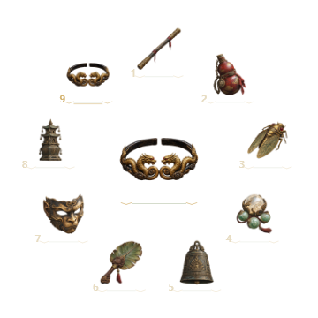
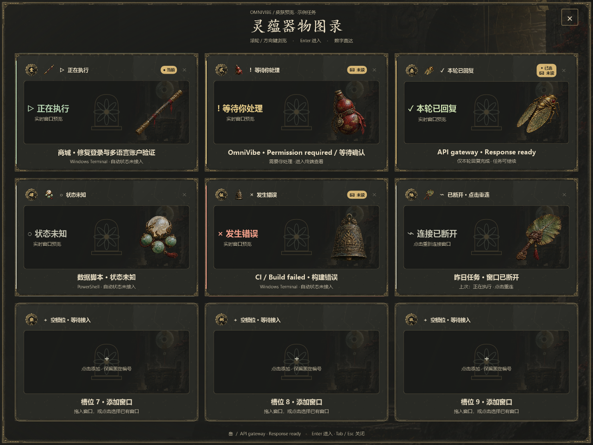
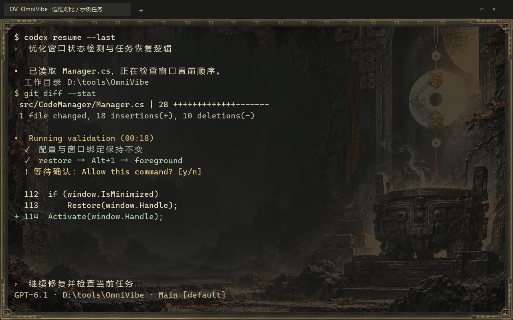

<p align="center"></p>
<h1 align="center">OmniVibe</h1>
<p align="center"><strong>像玩游戏一样，沉浸式 Vibe Coding。</strong><br>
窗口不再难找，任务随手切换，工作空间由你定义。</p>
<p align="center"><a href="README.md">简体中文</a> · <a href="README.en.md">English</a> · <a href="docs/project-kit/showcase.md">主题图册</a> · <a href="docs/project-kit/README.md">Docs</a> · <a href="CONTRIBUTING.md">Contribute</a></p>
<p align="center"><strong>WINDOW MANAGEMENT · GAME-INSPIRED INTERACTION · YOUR OWN STYLE</strong><br><sub>Windows · .NET 10 · Development preview · MIT code</sub></p>

**开了十几个终端，却总找不到刚才那个？** 写代码之外，你还在反复 Alt+Tab、辨认相似的标题、拖动窗口、调整大小。

**OmniVibe 把散落的终端和 AI Agent 窗口收进固定槽位，让你像切换游戏角色、装备或技能一样切换任务。** 平时是一个小巧入口，需要时展开轮盘；想同时看代码、日志和测试，一键排好。再用喜欢的角色、主题插画与声音，把工作桌面变成属于自己的沉浸式空间。

**少找窗口，多一点心流。让 Vibe Coding 更轻松，也更有趣。**

> **正在成长的开发预览版。** OmniVibe 已具备窗口收纳、快捷切换和排列等核心能力，但部分功能与交互仍未完善，兼容性也需要更多真实场景验证。欢迎体验、反馈问题、提交 PR，和我们一起把它打磨成更顺手、更有趣的 Vibe Coding 工具。[查看当前限制](#使用范围) · [参与贡献](CONTRIBUTING.md)

## 先看看效果

**默认主题：黑神话：悟空 · 灵蕴法宝匣。** 从轮盘、任务总览到终端外观统一氛围，音效默认跟随主题。音频需要本机安装对应资源；缺少资源时保持静音，也可以导入自己的 WAV。

<table><tr>
<td align="center"><br><strong>指向任务，切入状态</strong></td>
<td align="center"><br><strong>多个窗口，一眼看清</strong></td>
</tr></table>



<sub>展示图来自原生组件测试，包含示例任务；不是实时录屏。部分截图早于最新版本。游戏相关主题不代表官方合作。</sub>

## 把管理窗口的时间，还给创作

| 你遇到的麻烦 | OmniVibe 帮你做什么 |
| --- | --- |
| **窗口太多，总被遮住、找不到** | 集中收纳到 **1–9 固定槽位**，位置不因切换顺序打乱 |
| **反复 Alt+Tab，标题又长得一样** | **编号直达、鼠标轮盘、角色图标**，形成自己的任务记忆 |
| **想并排看日志和代码，排版很费劲** | **一键排列 / 恢复**，支持网格、分栏、分行、主窗居左 |
| **不知道哪个 Agent 在等我** | **任务总览 + 状态提示**；接入 CLI 事件后显示运行、等待、回复等状态 |
| **管理面板占地、工作桌面单调** | **小巧入口，悬停展开**；主题、配装图片、声音与动画可调 |

### 收纳 → 切换 → 排列 → 回到心流

1. **给任务一个固定位置。** 前端放 1 号、接口放 2 号、测试放 3 号。点击空槽选择窗口，或拖入终端标题栏。
2. **像游戏里切换一样自然。** `Alt + 1–9` 直达；按住 `Alt + Q` 呼出轮盘，指向后松键进入。入口支持悬停展开、长按左键拖动、右键管理。
3. **需要全局视野，就展开工作空间。** 总览查看预览；`Alt + 反引号` 排列已收录窗口，再按恢复原布局。

保留你原来的终端与 CLI 工作方式，可用于 Claude Code、Codex 等多窗口并行场景。**收纳、切换与排列不依赖 AI 状态接入。**

## 让工作空间有你的风格

**不止是武器和装备，也可以是你喜欢的角色、动物或动漫形象。** 把喜欢的图片变成任务标识，一眼认出自己的项目；轮盘、总览和终端外观相互呼应，再配上可调的音效与动画，让 Vibe Coding 更有沉浸感。

**默认黑神话，另外还有 12 套主题可选。** 完整图册按界面模块展示每套主题，可以点击查看原图。

### [浏览全部 13 套主题 →](docs/project-kit/showcase.md)

## 快速开始

当前是开发预览版，从源码运行需要 **Windows + .NET 10 SDK**，SDK 基线见 [global.json](global.json)。

```powershell
git clone https://github.com/Xiobio/OmniVibe.git
cd OmniVibe
powershell -ExecutionPolicy Bypass -File .\run.ps1
```

脚本编译并启动应用；已有管理器实例会先被请求正常退出。新配置默认使用黑神话主题，已有用户的主题与任务绑定会保留。

预览包的运行库、安装、更新与回退步骤见 [安装说明](docs/project-kit/INSTALL.md)。

**语言：** 右键入口 → 设置 → 通用 → **界面语言 / Language**，选择 English 或简体中文，保存并重启。默认跟随系统；也可通过 `--language=en` 启动参数临时指定英文。[查看英文界面与语言说明](docs/localization/README.md)。

| 默认操作 | 功能 |
| --- | --- |
| `Alt + 1–9` | 进入对应任务，再按恢复先前窗口状态 |
| `Alt + 滚轮` | 切换任务 |
| 按住 `Alt + Q` | 呼出轮盘，指向后松键进入 |
| `Tab` | 打开 / 关闭任务总览 |
| `Alt + 反引号` | 排列 / 恢复已收录窗口 |
| `Ctrl + Alt + Space` | 显示 / 隐藏入口 |
| 左键单击托盘图标 | 显示 / 隐藏悬浮圆盘 |

默认全局 `Tab` 会影响终端补全，可在设置中更换或关闭。隐藏入口后，**单击托盘仓鼠图标**可以找回。

## 使用范围

- **管理整个窗口**，暂不单独绑定 Windows Terminal 内部标签页或分屏。
- 自动状态依赖 CLI 事件；“本轮已回复”不代表整个任务完成。
- 支持自定义配装图片与现有主题配置，完整社区皮肤包 SDK 仍在规划中。
- 英文版覆盖应用菜单、设置与操作提示；用户任务名、终端内容和图片内文字保留原文。

[使用指南](docs/project-kit/getting-started.md) · [CLI 状态接入](docs/usage.md) · [FAQ](docs/project-kit/faq.md) · [开发指南](docs/project-kit/development.md) · [路线图](docs/project-kit/roadmap.md)

## 一起把 Vibe Coding 变得更有趣

**这个工具还没有完成，我们期待和大家一起完善它。** 无论是修复一个交互问题、验证多显示器与缩放体验、改进 CLI 状态接入，还是补充翻译、文档和来源明确的主题素材，都很有帮助。不会写代码也欢迎提交复现步骤与使用建议。

项目采用 **C# / WPF / Win32**，程序与源码目录仍使用 `CodeManager` 名称。

[贡献指南](CONTRIBUTING.md) · [更新记录](CHANGELOG.md) · [安全说明](SECURITY.md)

自有代码、脚本和文档使用 **[MIT License](LICENSE)**。第三方图像、角色、商标与音频的权利另行说明，参见 [THIRD_PARTY_NOTICES.md](THIRD_PARTY_NOTICES.md)。本项目与相关游戏厂商无官方合作关系。
