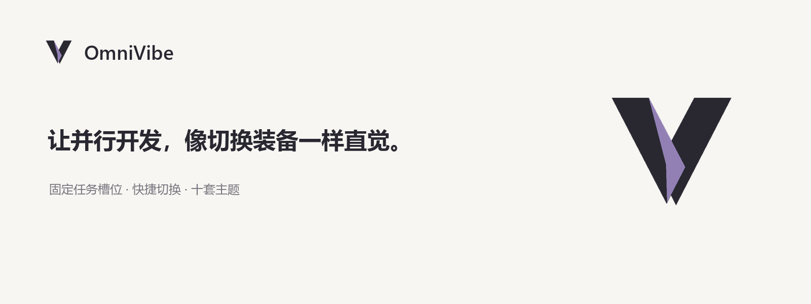

# OmniVibe



**The Open-Source Task Inventory for Vibe Coding**

让并行开发，像切换装备一样直觉。

OmniVibe 是面向多 AI Agent 并行开发的 Windows 桌面任务装备核心。平时只有一个 116×116 的悬浮装备入口，鼠标移上去展开任务，点击切换，移开收回。用熟悉的角色、武器或藏品辨认窗口，任务详情悬停即显；终端与任务身份始终独立于外观。

项目以完全开源、可切换皮肤和社区自定义皮肤为目标。当前为本地开发版，源码及程序名称仍使用 `CodeManager`，技术栈为 C# / WPF / Win32。

## 当前能力

- 拖入或选择已有窗口，收纳、切换和排列任务。
- 常驻装备入口支持悬停展开、长按拖动位置；空槽的轻量「＋」直接添加窗口，悬停「×」移出管理并保留终端。
- 使用 `Alt + 1–9`、`Alt + 滚轮` 快速进入任务。
- 按住 `Alt+Q` 打开九方向任务轮盘，指向后松键切换。
- 使用 `Tab` 打开任务总览，查看窗口预览与任务状态。
- 接入 Claude Code / Codex hooks，显示运行、等待、本轮已回复等状态。
- 保存任务配置，重连窗口或恢复已配置的工作现场。
- 内置十套完整风格皮肤及三套经典主题，覆盖任务栏、总览、菜单、设置和状态反馈。
- 13 套内容包各有 9 个独立透明实体，共 117 张；内置配装按主题分别记忆，导入图片随任务跨主题保留。
- 13 套声音各覆盖 14 种操作，共 182 段原创音效；支持音量、轻声／沉浸、状态提醒，以及主题或角色级自定义 WAV。
- 配套十套 Windows Terminal 外观，包含原创插画、动态边饰与配色；可在设置中单独应用，自动备份原配置。
- 动画、音效与装饰独立开关，换肤保留任务绑定、窗口位置与会话信息。

社区皮肤包的导入、独立制作和分发属于后续建设目标，当前尚未提供完整开放皮肤机制。开源发布前还需确定并添加许可证。

## 快速启动

需要 Windows、.NET 10 SDK 和 Windows Desktop Runtime。在项目根目录执行：

```powershell
powershell -ExecutionPolicy Bypass -File .\run.ps1
```

启动后，将终端窗口标题栏拖到侧栏空槽，或点击空槽选择窗口，再使用 `Alt + 编号` 唤出任务。右键任务可编辑信息和连接 CLI 状态。

当前按整个窗口绑定，不支持单独绑定 Windows Terminal 内部标签页或分屏。`Tab` 默认全局接管，会影响终端补全，可在设置中关闭或更改。

当前使用 Debug 开发版；`artifacts/CodeManager` 是不随源码更新的早期产物。退出工具会恢复其收起的窗口，CLI 继续运行。

## 文档

- [产品定义](docs/product-definition.md)：定位、核心交互、开放皮肤机制和首版范围。
- [皮肤设计候选](docs/skin-design-candidates.md)：10 套游戏风格皮肤方向、统一状态规则和建议制作顺序。
- [皮肤图册](docs/skin-gallery/index.html)：十套真实界面截图与设置预览（下载后用浏览器打开）。
- [整套配装实拍](docs/game-suite-refinement/index.html)：13 套内容在圆盘、总览与配装页的真实效果。
- [音效试听](docs/game-audio/index.html)：逐主题试听 14 种操作声音。
- [内容包规范](skins/loadouts/suites-v1/README.md)：素材来源、原生尺寸、提示词与九实体替换约定。
- [皮肤校准记录](skins/VALIDATION.md)：可读性、状态、布局与回归验证。
- [Terminal 套装](docs/terminal-skins.md)：十套配套终端外观与恢复方法。
- [品牌与宣传素材](assets/brand/v2/README.md)：桌面图标、产品图标、图标动效、发布图与可编辑源文件。
- [代码分析与评测](docs/reviews/2026-10-19-code-review.md)：架构、独立回归、性能实测、发现项与发行准备。
- [使用与开发指南](docs/usage.md)：完整操作、快捷键、状态接入、数据恢复和开发检查。
