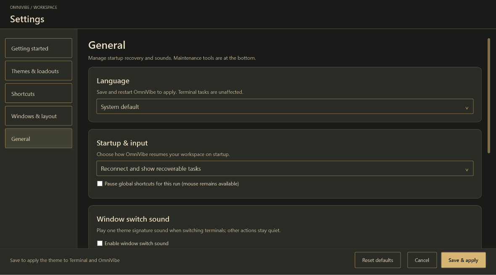
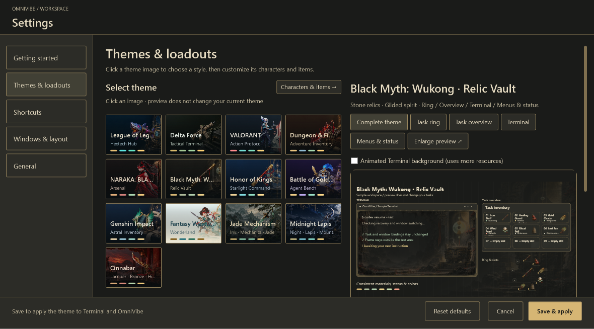

# Language / 界面语言

OmniVibe supports English and Simplified Chinese. Right-click the launcher → Settings → General → Language. Save and restart to apply.

The default follows the OS UI language: Chinese systems use Simplified Chinese; other systems use English. A launch argument `--language=en` or `--language=zh-CN` overrides the saved preference for that process. `OMNIVIBE_LANGUAGE` provides the same override when no argument is given.

应用支持英文与简体中文。右键入口 → 设置 → 通用 → 界面语言，保存并重启生效。命令行指定的语言优先于保存的选择；若要恢复设置中的语言，请不带语言参数启动。

## Translation boundaries

Menus, settings, navigation, status labels, shortcuts, and built-in theme metadata use English resources. Task names, project paths, session IDs, terminal output, external event messages, asset provenance, and text drawn into images retain their original content. This avoids rewriting user data or changing event protocol identifiers.

Built-in equipment uses English labels derived from its stable item IDs. Custom image names remain unchanged. Artwork itself is shared between languages.

## Contributor notes

- Application strings live in `src/CodeManager/Localization/en.tsv`, embedded in the executable. No network translation service is used.
- Use `L.T` for application-owned literals and `L.F` for interpolated UI text. Preserve formatting arguments.
- Never localize persisted identifiers, event matching, user text, filenames, or paths.
- Theme metadata is cached separately for each language in `SkinCatalog`.
- Run `CodeManager.exe --localization-test <absolute-output.json> --language=en` to check resource structure, defaults, task data preservation, and theme metadata.

Fresh preferences use the Relic theme. A saved theme is not overwritten during upgrade. Sound follows the theme unless explicitly overridden and requires locally available audio.
