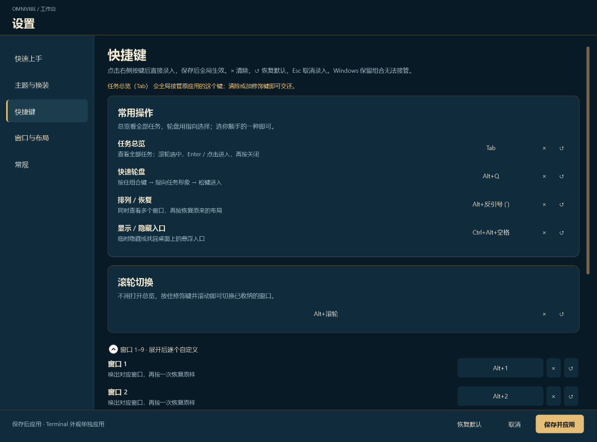

# 主题展示

[← 返回 OmniVibe 项目介绍](../../README.md) · [English](showcase.en.md)

**窗口整理好，风格由你定。** 这里完整展示 **黑神话默认主题 + 其余 12 套，共 13 套主题**，按轮盘、任务总览和终端外观分模块浏览。点击缩略图可以查看原图。

选择喜欢的视觉风格，再用角色、动物或自定义图片作为任务标识。主题负责营造氛围；固定槽位、快捷切换、一键排列和状态接入的操作方式保持一致。

[默认主题](#默认--黑神话悟空) · [任务轮盘](#任务轮盘--12-种风格) · [任务总览](#任务总览--统一掌握进度) · [终端外观](#终端主题--从入口到工作现场)

## 默认 · 黑神话：悟空

**默认主题：黑神话：悟空 · 灵蕴法宝匣。** 从轮盘、任务总览到终端外观统一氛围，音效默认跟随主题。音频需要本机安装对应资源；缺少资源时保持静音，也可以导入自己的 WAV。

<table><tr>
<td align="center"> <strong>指向任务，切入状态</strong></td>
<td align="center"> <strong>多个窗口，一眼看清</strong></td>
</tr></table>

展示图来自原生组件测试，包含示例任务；不是实时录屏。部分截图早于最新版本。游戏相关主题不代表官方合作。

### 任务轮盘 · 12 种风格

<table>
<tr>
<td align="center"> 墨玉机关</td>
<td align="center"> 玄夜青金</td>
<td align="center"> 朱砂藏锋</td>
</tr>
<tr>
<td align="center"> 英雄联盟 · 海克斯枢纽</td>
<td align="center"> 三角洲行动 · 战术终端</td>
<td align="center"> 无畏契约 · 行动协议</td>
</tr>
<tr>
<td align="center"> 地下城与勇士 · 冒险装备栏</td>
<td align="center"> 永劫无间 · 无间兵器匣</td>
<td align="center"> 王者荣耀 · 星曜指挥台</td>
</tr>
<tr>
<td align="center"> 金铲铲之战 · Agent 备战席</td>
<td align="center"> 原神 · 星旅背包</td>
<td align="center"> 梦幻西游 · 三界百宝袋</td>
</tr>
</table>

### 任务总览 · 统一掌握进度

<table>
<tr>
<td align="center"> 墨玉机关</td>
<td align="center"> 玄夜青金</td>
<td align="center"> 朱砂藏锋</td>
</tr>
<tr>
<td align="center"> 英雄联盟 · 海克斯枢纽</td>
<td align="center"> 三角洲行动 · 战术终端</td>
<td align="center"> 无畏契约 · 行动协议</td>
</tr>
<tr>
<td align="center"> 地下城与勇士 · 冒险装备栏</td>
<td align="center"> 永劫无间 · 无间兵器匣</td>
<td align="center"> 王者荣耀 · 星曜指挥台</td>
</tr>
<tr>
<td align="center"> 金铲铲之战 · Agent 备战席</td>
<td align="center"> 原神 · 星旅背包</td>
<td align="center"> 梦幻西游 · 三界百宝袋</td>
</tr>
</table>

### 终端主题 · 从入口到工作现场

<table>
<tr>
<td align="center"> 墨玉机关</td>
<td align="center"> 玄夜青金</td>
<td align="center"> 朱砂藏锋</td>
</tr>
<tr>
<td align="center"> 英雄联盟 · 海克斯枢纽</td>
<td align="center"> 三角洲行动 · 战术终端</td>
<td align="center"> 无畏契约 · 行动协议</td>
</tr>
<tr>
<td align="center"> 地下城与勇士 · 冒险装备栏</td>
<td align="center"> 永劫无间 · 无间兵器匣</td>
<td align="center"> 王者荣耀 · 星曜指挥台</td>
</tr>
<tr>
<td align="center"> 金铲铲之战 · Agent 备战席</td>
<td align="center"> 原神 · 星旅背包</td>
<td align="center"> 梦幻西游 · 三界百宝袋</td>
</tr>
</table>

终端配色、插画和边饰可与主题协调，保留 Windows Terminal 原生标题栏；应用前备份配置。背景默认静态，动画可独立设置。

## 选择与自定义

右键入口 → 设置 → 主题与配装。先选择主题，再挑选角色或导入自己的任务图片。音效默认跟随主题，也可以独立调整；需要本机已有对应音频资源。

下载仓库后，用浏览器打开 [离线交互图册](../showcase/index.html)，可切换 13 套主题及轮盘、总览、配装、终端四种视图。GitHub 中的 HTML 链接显示源文件，下载后打开即可交互。

## 设置与引导

快捷键可以按自己的使用习惯调整。截图是开发阶段的设置快照，当前文案或布局可能有变化。

## 主题目录

| 风格 | 资源标识 |
| --- | --- |
| 墨玉机关 | ink-jade |
| 玄夜青金 | midnight |
| 朱砂藏锋 | cinnabar |
| 英雄联盟 · 海克斯枢纽 | hextech |
| 三角洲行动 · 战术终端 | tactical |
| 无畏契约 · 行动协议 | protocol |
| 地下城与勇士 · 冒险装备栏 | adventure |
| 永劫无间 · 无间兵器匣 | arsenal |
| 黑神话：悟空 · 灵蕴法宝匣 | relic |
| 王者荣耀 · 星曜指挥台 | starlight |
| 金铲铲之战 · Agent 备战席 | formation |
| 原神 · 星旅背包 | astral |
| 梦幻西游 · 三界百宝袋 | wonderland |

名称描述主题方向，不代表官方合作或授权。素材范围见 [声明](../../THIRD_PARTY_NOTICES.md)。

## 展示证据与使用方式

- 圆盘、总览、配装：来自 `docs/game-suite-refinement/screens/` 的原生组件测试截图，使用示例任务。
- Terminal：来自 `docs/terminal-frame-refinement/` 的外观测试图。
- 设置：来自 `docs/settings-and-onboarding/` 的开发快照。
- 当前图标：[窗口仓鼠 v4](../../assets/brand/v4/README.md)，包含透明 PNG 和 Windows ICO。
- 历史品牌图与动画：[品牌档案](../../assets/brand/README.md)，旧版素材不代表当前仓鼠图标。

图册收录已有开发产物，部分早于最新源码；它展示视觉设计，不证明全部交互已经验收，也不证明帧率、延迟或内存水平。发布演示视频时请录制实际操作，注明版本，不以品牌图标动画代替产品交互录像。

**[← 返回项目介绍与快速开始](../../README.md)**
