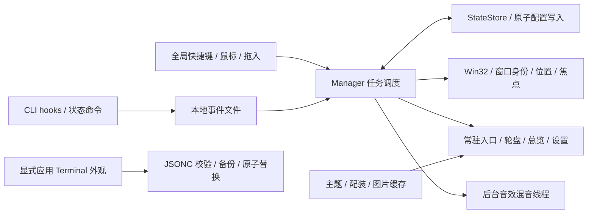

# OmniVibe 全面代码分析与评测

评测日期：2026-10-19。开发会话完成后独立构建、执行验证，覆盖当前应用、主题与配装、音效、Terminal 集成、生成工具及监控脚本。

**总体判断：当前版本已经是功能可用、交互防护较完整的 Windows 开发预览版，适合继续日常试用；尚不足以据此宣称完成稳定公开发行。** 主要短板是异常配置的深层校验、断流状态的表达、长期及跨环境验证，以及许可证和发布工程。当前架构可以继续演进，没有发现必须更换技术栈或重做终端标题栏的依据。

本文区分本轮亲自运行的结果、源码判断和未验证场景。完整计数、命令、环境、源码哈希见 [机器可读证据](2026-10-19-evidence.json)。测试通过不是没有缺陷的证明；本轮额外探针确实发现了一个既有回归未覆盖的问题。

## 1. 版本边界与评测方法

- 确认开发会话于 **19:58（Asia/Shanghai）完成、空闲且无待执行消息** 后开始最终检查。未创建新的开发或监督代理。
- 基线提交为 `1f39ef496e31a5f8dc317b2f65b4b7aaae106b22`，同时纳入工作区中尚未提交的品牌图标、文档与相关工具。不能仅凭该旧提交号复现整个被测工作区，应结合本报告所在提交及证据中的文件哈希。
- 应用、工具与关键清单的汇总指纹为 `e4cc19d696f512c01bac6b9cf2614e0a3fcae7a3a3f502e04a17770dc543bf33`。所有验证完成后再次逐项核对，代码与关键配置未变。
- SHA-256 记录本次 Windows 工作区的原始字节；Git 换行转换可能使另一份检出的字节哈希不同。证据另附 122 个对应 Git blob ID，供跨检出核对；本报告不宣称跨机器构建产物逐字节一致。
- 在 `artifacts/code-review/app` 构建 **Release**，没有替换运行中的开发程序。Terminal 写入和恢复测试使用隔离配置。
- 分层检查全部源码目录，重点走查窗口身份、任务迁移、恢复握手、事件路由、全局输入、绘制与资源缓存、音效线程及配置写入。补充一个独立诊断程序检验异常配置和实际图片解码。
- 评测前后对照现有任务的固定编号、任务 ID、窗口身份、主题和配装摘要，并比较真实 Terminal 配置哈希：**4 个现有任务保持一致，Terminal 配置未变**。没有将个人任务文件或终端内容纳入公开证据。

## 2. 项目规模与真实技术形态

下表是开始最终评测、尚未加入本文和证据文件时的仓库快照；包含非忽略的未提交文件，排除 `bin`、`obj`、`artifacts` 和 Python 缓存。

| 项目 | 实际结果 |
| --- | --- |
| 仓库文件 | 1,148 个，约 384.4 MiB |
| 源码与构建文件 | 116 个 |
| C# 物理行数 | 9,347 行，包含验证工具与测试 |
| Python / PowerShell | 3,104 / 1,024 行 |
| XAML / HLSL | 93 / 837 行 |
| 图片资源 | 712 个栅格文件，约 358.2 MiB；另有 17 个 SVG |
| 主题与实体 | 13 套主题，每套 9 个实体，共 117 张 |
| 操作音效 | 13 × 14，共 182 个 PCM WAV |

当前实现是 **C# / .NET 10 / WPF / Win32**，不是产品最初设想中的 Tauri / React。它通过操作已有窗口的前景、位置与最小化状态提供任务调度，不解析终端协议，也没有为每个任务重建终端进程。配套 Terminal 外观使用原生配置、预合成图片及 GIF；顶部配色没有额外实现一套标题栏。

程序仍按整个窗口绑定，Windows Terminal 标签页和分屏不是独立任务。状态来自显式 hooks 或本地事件，不能把“窗口存在”解释为“AI 仍在执行”，也不能把 Running 解释为已经证明代码生成正常。

## 3. 架构与职责

| 模块 | 已有设计及评价 |
| --- | --- |
| `Models` / `Manager` | 任务 ID 与槽位编号分离；移动任务时携带配装、状态与恢复信息。固定位置交互有清晰数据基础。 |
| `Native` | 窗口句柄之外校验 PID，能够读取时再校验进程启动时间，降低句柄复用导致错绑的风险。前景切换、位置恢复与缩略图集中封装。 |
| `InputService` | 低级输入回调主要做路由并投递 UI 操作；快捷键冲突有提示，暂停和对话框期间让出操作。避免在全局钩子里执行磁盘任务。 |
| `StateStore` / 恢复流程 | 临时文件写入后替换配置；损坏 JSON 先备份。恢复使用明确会话 ID、随机启动令牌与 ready 文件握手，拒绝通用标题和歧义匹配。 |
| hooks / 事件消费 | 按任务 ID 和事件时间路由，过滤子代理及部分陈旧会话。每批最多处理 24 条，批量保存、合并通知，保存失败保留待消费文件。 |
| 配装与视觉 | 每个主题保存独立选择；自定义图片与任务身份分开。显示副本、原始素材、导入文件分开处理；缺失素材有兼容回退。 |
| 音效 | 私有后台线程混音，限制待处理请求和同时发声数量，支持节流、优先级、静音与主动试听；原生输出能够停止和释放。 |
| Terminal 集成 | 显式应用才改配置；校验依赖和 JSONC，保留无关字段，检测并发修改，提供原始字节备份和恢复。 |

资源释放也有实质覆盖：总览关闭注销 DWM 缩略图，输入服务释放钩子与热键，预览隐藏或关闭停止 GIF 时钟并释放流，退出时恢复由工具收起的窗口。这些比装饰效果本身更关系到长期使用可靠性。

架构的主要负担集中在 [Manager.cs](../../src/CodeManager/Manager.cs)：971 行内承担恢复、布局、输入协调、状态消费、窗口捕获和设置应用。当前规模仍可维护，但继续堆功能会扩大联动修改面。适合逐步抽出事件消费、窗口恢复与音效路由服务，而非立即进行整体框架迁移。

## 4. 独立验证结果

环境：Windows 11 专业版 64 位，Build 26200；i7-12700KF、20 个逻辑处理器、约 64 GiB 内存；.NET SDK 10.0.102、PowerShell 5.1、Python 3.13.5。Python 工具使用 Pillow 11.1.0、numpy 2.1.3、scipy 1.15.3、imageio-ffmpeg 0.6.0。

| 验证项 | 本轮结果 | 范围与限制 |
| --- | --- | --- |
| Release 构建 | 通过；0 警告、0 错误 | 完整当前工作区应用；不等于安装器或发行签名验证 |
| 主回归 | **39 / 39 组** | 其中已包含 21 组皮肤与交互检查，不能再重复计入独立总数 |
| 配装 | **12 / 12 组** | 来源与完整性、独立选择、草稿、兼容、命中区域及任务迁移等 |
| 设置工作室 | **6 / 6 组** | 13 个选择、5 种预览、保存/取消、窄短布局与播放释放 |
| 音效引擎 | **8 / 8 组** | 182 个文件、畸形 WAV、导入与回退、有界调用、静音、试听和原生输出释放 |
| Terminal 套装 | **10 套通过 + 8 个反例通过** | 使用真实仓库素材，隔离设置；备份恢复与无关命令、快捷键保留 |
| 原生顶部配色 | **13 主题，15 个单项及 3 个批量场景通过** | 保留原生控件和无关配置 |
| GIF 原生解码 | **20 个 GIF、1,920 帧通过** | 检查 96 帧、正文区稳定和边缘变化；未声称本轮目视验证真实 Terminal 播放 |
| 监控调度 | **7 / 7 项通过** | 模拟会话状态、用户队列优先及避免重复调度；不是联网通知端到端测试 |
| 工具与资源 | 无解析或本地静态路径错误 | 19 个 Python、11 个 PowerShell、9 个 XML/XAML、17 个 SVG、712 个栅格首帧及 676 个相对引用 |
| 强格式令牌扫描 | 247 个文本文件未命中 | 只覆盖若干明确令牌、私钥及字面密钥格式，不构成完整安全审计 |

主回归不仅是纯函数断言，还创建自有窗口验证了激活、收起与恢复、DWM 预览、覆盖窗口的 Z 序、固定编号、拖入、移除、最近关闭、焦点与快捷键降级。它仍然是夹具环境，不能替代真实 CLI 长时间运行和所有 Windows 环境的验证。

本轮额外目视检查了海克斯、梦幻西游的原生总览夹具，以及品牌总览、横幅和小尺寸图标。深浅主题都使用文字和符号区分执行、等待、回复、错误与断连，降低了只依赖颜色识别的负担。截图使用示例任务；没有将截图里的状态当作真实 Agent 活动证据，也没有声称逐张目视验收了全部 117 个实体。

## 5. 性能实测与解释

### 5.1 轮盘绘制

`--wheel-benchmark` 在独立进程中采集 180 个预热后样本：

| 指标 | 实测 |
| --- | --- |
| 绘制记录中位数 | 0.0936 ms |
| p95 / 最大值 | 0.1638 / 0.7684 ms |
| 平均线程分配 | 约 14.1 KiB / 次绘制 |

这测的是 **UI 线程记录绘图命令**，不包含 Windows 合成、GPU 呈现、真实鼠标输入、目标终端激活和内容刷新。因此不能把它写成“切换窗口只要 0.16 ms”。数据说明绘图命令记录本身成本较低，但尚无端到端延迟和长期 GC 曲线。

### 5.2 图片与内存

独立运行素材压力工具，强制 `CopyPixels` 使 WIC 真正解码，避免仅测图片头：

| 场景 | 实测 |
| --- | --- |
| 首次载入并物化永劫无间 9 张显示图 | 约 167.9 ms |
| 同主题 900 次热缓存调用 | 中位数 0.0005 ms，p95 0.0007 ms |
| 连续轮换全部 13 套 | 每套约 60–117 ms，所有内容包存在 |
| 轮换后缓存 | 49 项，像素估算约 **47.7 MiB**，最长边 512 px |
| 该探针进程私有字节 | 初始约 13.1 MiB，轮换后约 62.7 MiB |

当前代码采用 **512 px 显示解码、72 项 LRU 与 48 MiB 像素预算**，不会因为轮流查看 117 个实体而无限保留全部原图。导入原图和原始素材没有因显示缓存而被改写。另一个独立探针对最多 90 张实际图片做了物化，观察到的私有内存增量约 51.2 MiB，与有界缓存方向一致。

48 MiB 是图片缓存的像素预算，**不是整个 OmniVibe 进程的内存上限**。WPF、原生解码器、窗口、其他纹理和音频都需要额外内存；上述小程序也不是常驻主程序。首批加载仍有百毫秒级成本，应继续关注首次启动、首次展开和首次换肤，而不能只展示热缓存的微秒级数字。

### 5.3 音效与 Terminal

音效文件与格式检查、原生输出及停止检查均通过。引擎把文件读取和混音放在后台线程，限制 4 个并发声音与待处理请求，并对过时请求及连续悬停节流。三个 256 帧缓冲在 44.1 kHz 下对应约 17.4 ms 的缓冲长度，**不是实测输入到耳朵的总延迟**。本轮没有进行声学延迟测量或整套主观音质验收。

Terminal GIF 由 Terminal 自身消费，不能把 GIF 解码成本混入上述 WPF 绘图时间，也不能根据 OmniVibe 的低绘图耗时断言终端背景没有额外 GPU/CPU 成本。关闭动画与装饰的回退路径已经有功能验证，但真实 Terminal 的长时占用仍需单独测量。

## 6. 发现项与建议优先级

优先级含义：P1 为对外发行前应解决的门槛，P2 为近期可靠性与体验工作，P3 为维护和分发优化。源码推断和待测风险不写成已复现故障。

### F01 · P2 · 嵌套异常配置没有完整兜底〔已复现〕

[StateStore.Load](../../src/CodeManager/StateStore.cs#L21) 验证了槽位数量、ID、编号和部分偏好，但没有归一化 `Window.Title`。向一个原本合法的九槽配置注入 `Window.Title: null` 后，文件仍被接受；[ExistingMatch](../../src/CodeManager/RecoveryLaunch.cs#L55) 随后调用 `Title.Trim()`，抛出 `NullReferenceException`。

影响：手工编辑、外部工具写入或迁移得到“JSON 语法正确但结构异常”的配置时，重连流程可能中断；默认自动重连也会进入这条路径。这不是正常保存必然产生的问题，也不是远程执行漏洞。

建议：在加载边界验证或归一化所有嵌套字符串与对象，对无法接受的结构采用同样的备份与恢复提示；加入 `Title`、`ProcessName`、布局项和恢复字段的结构反例。异常 JSON 的备份流程本轮已通过，缺的是更深一层的结构保护。

复现：运行 [ReviewProbe](../../tools/code-review/README.md)，查看 `nestedNullTitle`；它只写独立夹具，不改个人配置。本轮结果为 `acceptedByStateStore=true`、`recoveryException=NullReferenceException`。

### F02 · P2 · hooks 断流后的状态可信度需要独立表达〔源码判断，待故障注入〕

窗口连接和 Agent 状态已经分离，这是正确基础。但 [事件应用](../../src/CodeManager/Manager.cs#L839) 仍主要依赖后续事件更新 `IntegrationConnected`，未见专门的 hooks 活性心跳或断流标记。CLI 异常终止、观察脚本未执行而宿主终端仍开着时，旧的 Running/Waiting 可能继续显示。连接说明里已有最近事件时间，常驻入口的表达仍可加强。

建议：展示“最后可信事件时间 / 状态可能陈旧”，结合 provider 能力设计活性检查；不要仅因长任务暂时没有事件就武断改成 Error。增加终端仍开着、CLI 已退出及 hook 丢失的故障场景验证。

### F03 · P2 · 状态积压扫描仍在界面线程〔源码风险，未测出卡顿〕

[ConsumeEvents](../../src/CodeManager/Manager.cs#L799) 已做到单批 24 条、合并通知和一次保存，应保留这些改进。但取前 24 条之前仍需枚举候选文件并读取时间信息，整个过程位于 500 ms 的 UI 心跳。处理条数有上限，不代表一个巨大目录的扫描成本也有上限。

建议：先用数千待处理文件及慢磁盘夹具测量 UI 响应，再决定是否转为后台有界扫描、通知唤醒和分批归并。为拒收文件及日志制定保留策略。不能只凭这一段代码断言正常九任务已经出现性能问题。

### F04 · P2 · 自绘入口的辅助功能与真实环境矩阵不足〔源码检查 / 未覆盖〕

设置中有可访问名称及键盘操作，但自绘轮盘和实体没有看到对应每个槽位的完整 UI Automation peer。全局数字键提供了键盘入口，仍不等于读屏软件可以获得每个实体的名称、任务、状态和操作语义。

建议：提供逐槽位可访问节点，并实际验证读屏、系统高对比度、关闭动画和仅键盘操作。现有 200% 绘制与命中夹具不能代替真实混合 DPI 双屏、跨屏拖动、RDP 和不同权限窗口测试。

### F05 · P1（发行门槛）· 代码许可与素材许可需要分开完成〔仓库事实〕

仓库根目录尚无 `LICENSE`、`LICENSE.md` 或 `LICENSE.txt`，README 也注明代码开源许可待确定。音效目录的 CC0 声明仅适用于其声明范围，不能自动扩展到整个项目。

实体清单已区分 AI 辅助风格演绎、参考原画的编辑衍生素材和部分原游戏图像，来源记录比“全部原创”这一笼统说法更准确。公开发行前应由项目所有者确定代码许可证，并按素材类别补齐许可说明与可分发范围。本文只记录仓库中已有说明，不认定这些记录本身已经证明第三方授权。

### F06 · P2（发行准备）· 自动化与可复现环境尚未形成统一入口〔仓库事实〕

目前有实质性测试，但没有看到 `.github` CI 流水线、固定 SDK 的 `global.json` 或统一锁定的 Python 构建依赖。多个独立命令由人工组织，历史校验 JSON 也不会因为代码改变自动失效。

建议：先增加 Windows 构建、主回归、素材清单及隔离 Terminal 测试的固定流水线，把源码/清单指纹、构建配置和结果一起保存。固定生成工具依赖。运行时 C# 工程没有额外 NuGet 包引用，不代表 .NET、Windows 或 Python 依赖已经做过完整漏洞评估。

### F07 · P3 · 编译主题与数据内容包的边界应继续明确〔架构判断〕

[SkinCatalog](../../src/CodeManager/SkinCatalog.cs#L31) 仍使用编译内枚举和配色，配装内容通过 JSON 加载。现有主题的九实体替换已经数据化；新增任意完整主题、渲染行为或社区插件仍需要改代码。它还不是完全开放的皮肤 SDK，当前 README 对这一点已经有说明。

建议：先稳定颜色、状态、实体、素材路径、版本及回退契约，再设计新主题注册与包验证。不要在接口尚未稳定时直接加载任意社区执行代码。保持系统调度与皮肤表现分离的方向即可，不需要因此重写标题栏。

### F08 · P3 · 仓库和分发资源偏重，历史生成入口较多〔量化事实 / 维护建议〕

图片占评测快照约 358.2 / 384.4 MiB。[工程内容项](../../src/CodeManager/CodeManager.csproj) 对 `skins/**/*` 和 Terminal 目录整体复制，运行资源、历史素材、提示词与验证记录没有细分分发。品牌目录同时保留初稿和 v2，旧生成器也仍存在。

建议：保留来源与历史证据，但给运行包建立明确资源清单；大图与下载 ZIP 可在发行资源中管理，避免不断放大克隆和发布体积。将 `build-brand-v2.py` 标为当前品牌入口，历史工具标为归档。当前最大文件约 10.2 MiB，本轮没有发现单文件超过 100 MiB 的提交候选；这里讨论的是维护成本，不是已有上传失败。

## 7. 已验证的防护及本轮未覆盖的风险

现有防护值得保留：窗口身份复核，任务 ID 与编号分离，事件时间和会话过滤，恢复令牌握手，启动参数的字面量/参数数组处理，图片路径限制和像素预算，WAV 分配前检查与严格 RIFF 解码，批量音效文件的暂存/回滚，以及 Terminal 的字节级备份恢复。没有为了视觉效果把运行中的终端内容重新托管到另一套仿真器。

本工具的事件通道是当前 Windows 用户目录里的本地文件，不是对抗同一用户恶意进程的认证协议；不会因为使用 UUID 就变成远程安全边界。`asInvoker` 与系统前景窗口规则也意味着跨权限目标需要额外兼容性验证。

以下结果本轮没有测量，不能标成通过：

- 24 小时以上稳定性、持续 hooks 洪峰和磁盘/权限故障下的长期行为。
- 真实多屏混合 DPI、休眠唤醒、RDP、音频设备热插拔及窗口权限混用。
- 多版本 Claude / Codex 的真实会话接入与恢复；现有脚本/夹具通过不能保证所有 CLI 版本兼容。
- 输入到屏幕、输入到声音的端到端延迟、GPU 占用和整机能耗。
- 全量人工素材审美验收、软件供应链审计、安装器升级回滚和正式代码签名。

## 8. 建议的下一轮工作

1. **先补可靠性边界：**修复 F01，补结构异常配置反例；测试 hooks 断流和事件积压，同时保留现有任务不误绑、不误关窗口的回归。
2. **再建立固定验证入口：**将本次手工组织的检查接入 Windows CI，保存匹配代码指纹的证据；增加真实双屏、设备切换及长时使用记录。
3. **完成发行准备：**确定代码许可与素材说明，收敛运行资源和品牌入口，再制作版本化安装/升级方案。社区皮肤机制按稳定契约推进。

本轮评测增加了可复用的 [快照与诊断工具](../../tools/code-review/README.md)，未为消除报告中的待办擅自修改核心行为。原始测试输出留在本机 `artifacts/code-review/`；公开证据只保留复核所需的结果、环境和文件指纹。
